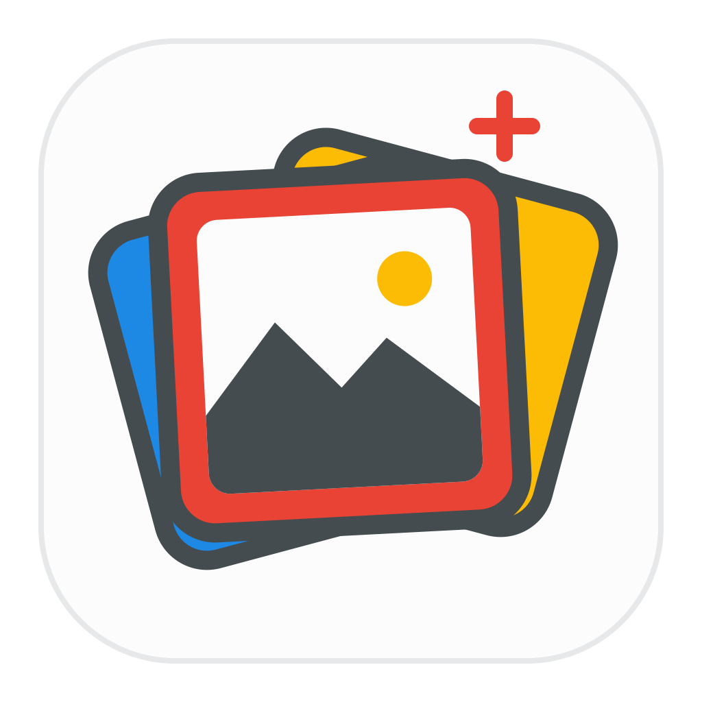

<p align="center"></p>

# Prompt Next

**A local-first desktop prompt manager for AI artwork and personas.** Organize Chinese and English prompts, models, and reference images in one workspace. Search, preview, copy, and back up your library.

[简体中文](README.md) · English · [繁體中文](README.zh-TW.md)

[](https://go.dev/)
[](https://wails.io/)
[](https://vuejs.org/)
[](https://www.typescriptlang.org/)
[](https://www.naiveui.com/)
[](https://vite.dev/)
[](https://sqlite.org/)
[](LICENSE)

## Features

- **Two libraries.** Browse AI art prompts and BigFish personas in a card grid or a three-pane list. Search, filter, sort, tag, categorize, and favorite entries. Multi-select for batch changes and undo deletions within 24 hours.
- **Artwork reference library.** Store bilingual prompts, multiple models, negative prompts, and generation parameters. Attach multiple images, preview them at full size, and drag to reorder. The first image is the card cover.
- **Copy and move your data.** Save named template presets, export Markdown or selected entries, and import legacy persona data. Full backups include referenced images and preferences. Replace restore creates a safety snapshot first.
- **Local dashboard.** See entry counts, recent updates, storage use, and charts. Choose light, dark, or system appearance, or open the data directory and preview orphan images for cleanup from Settings.

## Install and develop

Packages target **macOS Apple Silicon (DMG)** and **Windows x64 (EXE)**. Download a published build from GitHub Releases when available, or build it locally.

Development requires Go 1.26+, Node.js 24, npm, and Wails v3. macOS needs Xcode Command Line Tools. Windows uses WebView2 at runtime and NSIS for installer builds.

```bash
go install github.com/wailsapp/wails/v3/cmd/wails3@v3.0.0
wails3 doctor
wails3 dev
```

Add Go's binary directory to `PATH` if the shell cannot find `wails3`. Wails installs front-end dependencies and generates bindings on the first run.

```bash
wails3 task lint
wails3 task test
wails3 build
```

| Package | Command |
| --- | --- |
| macOS DMG | `wails3 task darwin:package:dmg` |
| Windows x64 NSIS | `wails3 task windows:package ARCH=amd64` |

Run each command on a host with the required toolchain. Output is written to `bin/`. Find your local app data via **Settings → Data Management → Open Folder**.

## Documentation

- [Development guide](doc/development.en.md) · Requirements, architecture, data, and packaging
- [Hands-on tutorial in Simplified Chinese](doc/开发教程.md) · Setup and exercises

[MIT licensed](LICENSE). The desktop build scaffolding is derived from the Wails template. [Wails license notice](licenses/Wails-MIT.txt)
