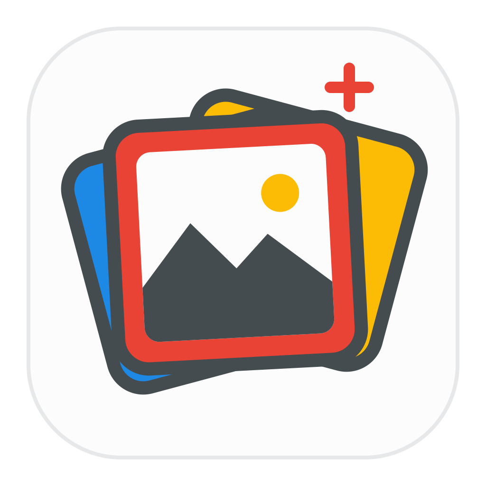
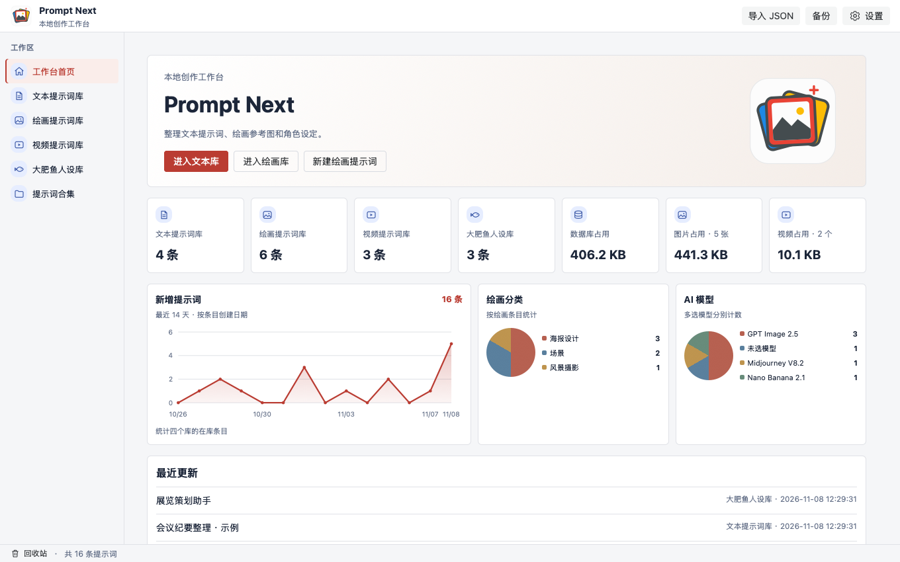

# Prompt Next

**本地优先的桌面提示词管理器。** 在一个工作台整理文本、AI 绘画、视频和人设提示词。

[English](README.en.md) · **简体中文** · [繁體中文](README.zh-TW.md)

## 工作台预览

## 功能

**四个独立提示词库。** 文本库直接预览正文，人设库维护角色设定。绘画库和视频库可保存中英文提示词、负向提示词、参数和多个 AI 模型。所有库都可填写分类、标签、说明、原作者和时间。

**图像与视频预览。** 绘画条目须添加效果图，视频条目须添加效果视频。两者都可另附生成前的参考图片。首张效果图或首段效果视频作为封面，图片支持拖动排序。图片弹窗支持前后切换，并显示文件名、大小、分辨率和格式。视频库可为同一条提示词附加多段 MP4 或 WebM，自动取首段画面作为封面。详情显示各段缩略图和文件大小，点击即可在弹窗播放。

**查找与整理。** 支持卡片、列表和瀑布流，可配置展示字段。可搜索标题、正文、编号和参数，按分类、标签、模型和收藏筛选，并按时间或标题排序。合集可把同一套提示词的不同变体放在一起。

**复用与批量操作。** 支持提示词折叠、变量预设、单段或整组复制、复制为新条目、Markdown 导出和批量 JSON 导出。支持批量收藏、改分类、删除。回收站支持 24 小时内恢复和彻底删除。

**本地工作台和偏好。** 首页展示四库数量、近 14 天新增提示词趋势、最近更新、附件占用，以及绘画分类和模型分布。可切换简体中文与 English、设置主题和视图、维护自定义模型和分类，或合并重复标签。

**数据备份。** 可选择数据文件夹、恢复默认目录和查看未引用图片。支持导入旧人设与应用备份。完整备份包含提示词、引用附件和库内设置，覆盖恢复前自动保存安全快照。

## 安装

前往 [GitHub Releases](https://github.com/Daneliya/prompt-next/releases) 查看已发布的安装包。

**macOS Apple Silicon**　下载 DMG，打开后将 Prompt Next 拖入「应用程序」。

**Windows x64**　下载 EXE 并运行安装向导。应用运行需要 WebView2。

## 文档

[开发文档](doc/开发文档.md) · 功能要求、工程分层、数据与发布

[开发教程](doc/开发教程.md) · 环境安装和动手练习

项目采用 [MIT 许可证](LICENSE)。桌面构建脚本源自 Wails 模板。 [Wails 许可声明](licenses/Wails-MIT.txt)

