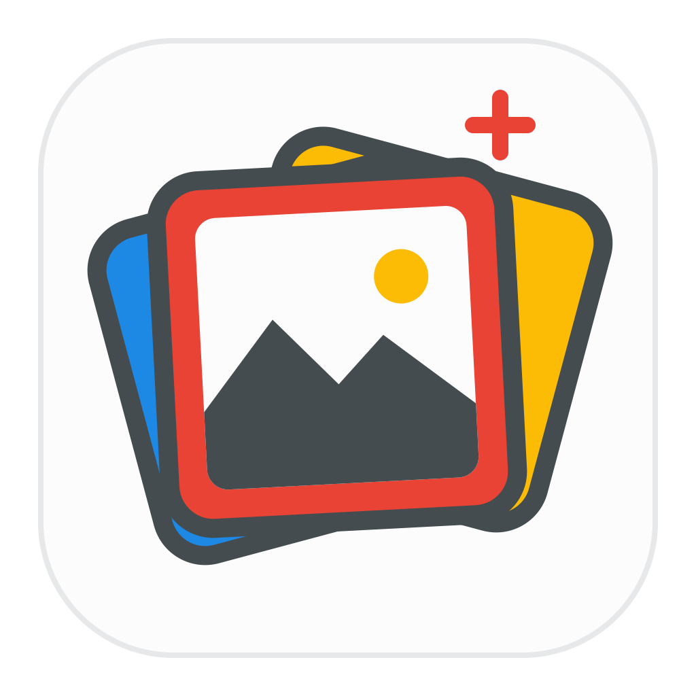
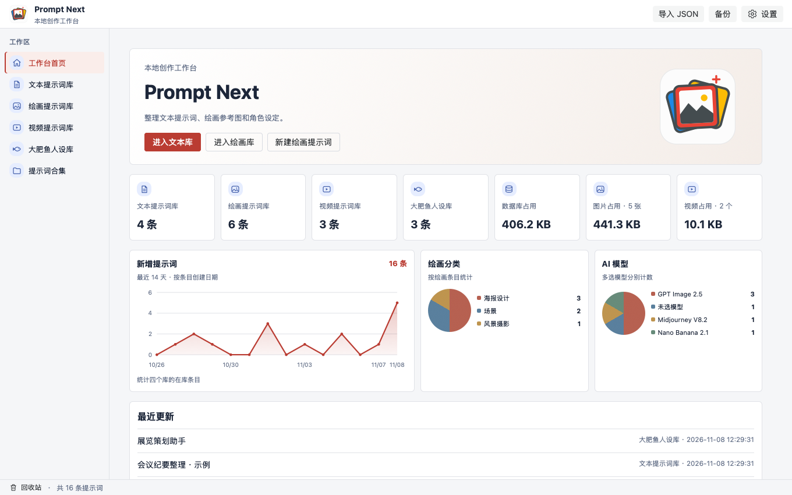

# Prompt Next

**以本機為主的桌面提示詞管理工具。** 在同一個工作台整理文字、AI 繪畫、影片與人設提示詞。

[English](README.en.md) · [简体中文](README.md) · **繁體中文**

## 工作台預覽

## 功能

- **四個獨立提示詞庫。** 支援文字、繪畫、影片和人設，可整理分類、標籤、原作者和時間。繪畫和影片也支援中英文提示詞、負向提示詞、參數和多個模型。
- **圖片和影片預覽。** 參考圖可排序，第一張作為封面。圖片彈窗支援切換與查看檔案資訊。影片條目可加入多段 MP4 或 WebM，在彈窗播放。
- **搜尋和整理。** 可切換卡片、清單和瀑布流，自訂顯示欄位，以標題、正文、編號搜尋，並用合集歸納提示詞變體。
- **複用和復原。** 支援範本變數預設、複製提示詞、匯出 Markdown 和批次操作。可在 24 小時內從資源回收筒復原，或永久刪除。
- **本機工作台。** 查看近 14 天新增提示詞趨勢、最近更新和儲存用量。可切換語言、主題和資料夾，備份附件與設定。覆蓋還原前會建立安全快照。

## 安裝

前往 [GitHub Releases](https://github.com/Daneliya/prompt-next/releases) 查看已發行的安裝檔。

- **macOS Apple Silicon。** 開啟 DMG，將 Prompt Next 拖入「應用程式」。
- **Windows x64。** 執行 EXE 安裝程式。應用程式需要 WebView2。

## 文件

- [簡體中文開發文件](doc/开发文档.md) · 需求、架構、資料和封裝
- [簡體中文開發教學](doc/开发教程.md) · 環境安裝和動手練習

採用 [MIT 授權](LICENSE)。桌面建置腳本源自 Wails 範本。 [Wails 授權聲明](licenses/Wails-MIT.txt)
